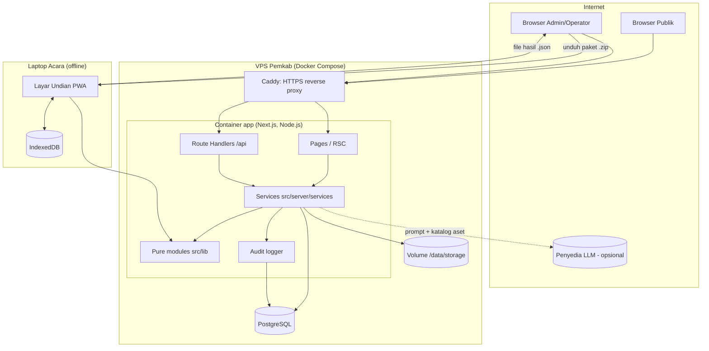
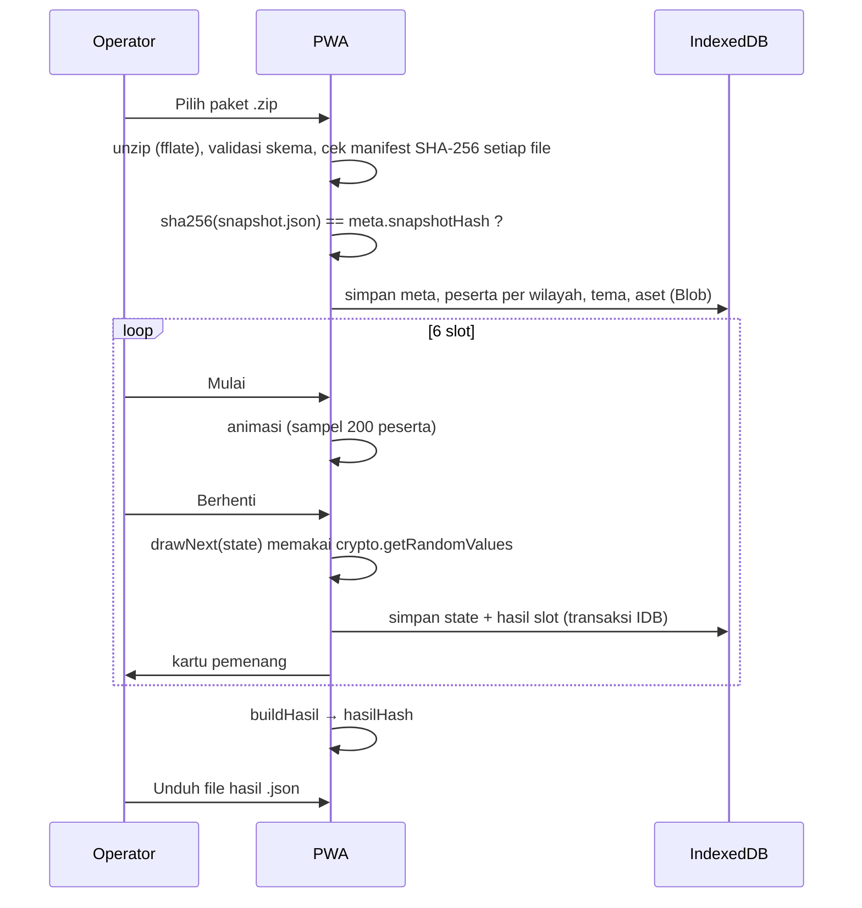

# Architecture

> Status: Draf v0.1. Turunan dari `PRD.md` dan `UX_FLOWS.md`. Skema data di `DATABASE.md`, kontrak di `API.md`, aturan keamanan di `SECURITY.md`.

## 1. System Overview

Satu aplikasi web Next.js (TypeScript) yang melayani tiga permukaan:

- **Panel Admin & Operator** (`/admin/*`, `/operator/*`) — online, butuh login.
- **Layar Undian** (`/operator/undian`) — PWA yang setelah dimuat bekerja **tanpa internet**. Data undian datang dari file paket `.zip`, disimpan di IndexedDB, dan hasil keluar sebagai file `.json`.
- **Halaman Publik** (`/`, `/pemenang`, `/cek`) — online, tanpa login.

Server berjalan di VPS Pemkab dalam Docker Compose: container aplikasi Next.js, PostgreSQL, dan reverse proxy (Caddy) untuk HTTPS. File (aset tema, snapshot kanonik, unggahan) disimpan di volume disk lokal.

Inti logika bisnis (aturan syarat, penyamaran, mesin undian, format & hash paket) ditulis sebagai **modul TypeScript murni** yang dipakai bersama oleh server dan browser, sehingga perhitungan hash dan aturan validasi identik di kedua sisi.

---

## 2. Architecture Pattern

Pattern:
Modular Monolith (Next.js App Router) + klien offline (PWA) yang bertukar data dengan server melalui file.

Reason:
- Skala kecil (±46.000 baris, puluhan pengguna internal, trafik publik sedang setelah pengumuman) — satu proses cukup.
- Tim kecil dan satu VPS; microservices hanya menambah biaya operasi.
- Modul domain murni menjaga logika kritis (syarat, undian, hash) mudah diuji dan tidak tercampur UI/DB.
- Pertukaran via file (paket & hasil) membuat undian bebas dari ketergantungan jaringan di lokasi acara dan memberi artefak yang bisa diarsipkan.

---

## 3. Technology Stack

Versi pasti dipin (exact) di `package.json` saat inisialisasi proyek dan dicatat di `CHANGELOG.md`.

Frontend:
Next.js (App Router, React Server Components + Client Components), React, TypeScript (strict), Tailwind CSS, lucide-react. Font di-bundle lokal (Plus Jakarta Sans, Inter, JetBrains Mono).

Backend:
Next.js Route Handlers (`src/app/api/**/route.ts`) di runtime Node.js. Validasi input dengan zod. Parsing CSV dengan papaparse, XLSX dengan exceljs. PDF dengan @react-pdf/renderer. ZIP dengan fflate (server & browser). Log dengan pino.

Database:
PostgreSQL 16 dengan Prisma ORM & Prisma Migrate.

Authentication:
Auth.js (NextAuth v5), Credentials provider (username + kata sandi), hash @node-rs/argon2 (argon2id), sesi JWT dalam cookie httpOnly. Status akun dicek ulang ke DB di setiap request terautentikasi (lihat `SECURITY.md`).

Storage:
Disk lokal VPS, volume Docker `app-storage` di-mount ke `/data/storage` (aset tema, snapshot kanonik, file hasil asli). Di-backup bersama database.

Hosting:
VPS Pemkab OKU Selatan, Docker Compose (`app`, `db`, `caddy`). HTTPS otomatis via Caddy. Detail di `DEPLOYMENT.md`.

Payments:
Tidak berlaku — tidak ada transaksi.

Email:
Tidak berlaku — tidak ada notifikasi email (non-goal PRD).

Analytics:
Tidak berlaku — tidak memakai layanan analitik pihak ketiga. Statistik cek NOP dihitung dari log aplikasi (lihat `OBSERVABILITY.md`).

Other Services:
- LLM via API untuk Asisten AI Tema (penyedia masih open question; diakses lewat adapter `src/server/ai/`). Opsional — aplikasi berjalan penuh tanpa ini.
- PWA: @serwist/next (service worker, precache).
- IndexedDB: pustaka `idb`.
- Hash: Web Crypto API (`crypto.subtle.digest('SHA-256')`) di browser dan Node.js; RNG: `crypto.getRandomValues`.
- Captcha ringan: proof-of-work mandiri (mis. ALTCHA) tanpa layanan pihak ketiga — perlu konfirmasi, lihat `DECISIONS.md`.

---

## 4. System Components

### Frontend

Responsibilities:
- Panel Admin: periode, impor & laporan, pemetaan wilayah, kunci, tema & pratinjau, paket, pemenang, berita acara, pengguna, log audit.
- Panel Operator: unggah hasil.
- Layar Undian (PWA offline): muat & verifikasi paket, simpan ke IndexedDB, jalankan 6 slot dengan animasi/audio dari `ThemeConfig`, pemulihan setelah crash, ekspor file hasil, hapus data lokal.
- Halaman Publik: pemenang & cek NOP.
- Tidak pernah menerima NIK utuh, kecuali aksi admin "Tampilkan NIK" untuk kandidat pemenang (SECURITY.md §6).

### Backend

Responsibilities:
- Autentikasi, otorisasi peran, rate limit.
- Impor file → evaluasi syarat (memakai `src/lib/domain`) → simpan batch.
- State machine periode (Draf → Terkunci → Diundi → Final → Dipublikasi) dengan optimistic concurrency (`version`).
- Kunci snapshot: susun `snapshot.json` kanonik (`src/lib/package`), hitung SHA-256, simpan.
- Susun paket `.zip`; verifikasi file hasil.
- Status pemenang & kenaikan cadangan.
- Berita acara PDF, ekspor Excel.
- Pustaka aset & tema, adapter AI.
- Log audit semua aksi penting.

### Database

Responsibilities:
- Sumber kebenaran: pengguna, periode, peserta, pemetaan, snapshot, hasil, status pemenang, tema, aset (metadata), berita acara, log audit.
- Menjamin integritas lewat constraint (unik, FK, enum) dan transaksi.

### Shared Pure Modules (`src/lib`)

| Modul | Isi | Dipakai oleh |
|---|---|---|
| `src/lib/domain` | `normalizeNop`, `formatNop`, `maskNop`, `maskNik`, `isValidNik`, `normalizeKecamatan`, `parseTanggalLunas`, `evaluateEligibility`, kode alasan | Server (impor, cek publik), Browser (tampilan) |
| `src/lib/draw` | `secureRandomInt`, `SLOT_URUTAN`, `createDrawState`, `drawNext`, `serializeDrawState` | Browser (Layar Undian), Server (verifikasi), CLI simulasi |
| `src/lib/package` | `canonicalStringify`, `sha256Hex`, skema zod `MetaSchema`, `SnapshotSchema`, `HasilSchema`, `ThemeConfigSchema`, `buildHasil`, `verifyHasil` | Server & Browser |

---

## 5. Architecture Diagram



Lapisan request online:
`Browser → Caddy → Route Handler / Server Component → Service → (Pure module) → Prisma → PostgreSQL`

---

## 6. Data Flow

### 6.1 Request online standar (contoh: simpan pemetaan)
1. Admin menekan "Simpan Pemetaan"
2. Komponen klien memvalidasi bentuk input dengan skema zod yang sama dengan server
3. `PUT /api/periode/:id/wilayah`
4. Handler: `requireRole('ADMIN')` (cek sesi + akun aktif di DB) dan cek `Origin`
5. Service memvalidasi aturan bisnis (periode Draf, satu kecamatan satu wilayah, `version` cocok)
6. Transaksi Prisma: update pemetaan + tulis `audit_log`
7. Respons JSON standar (`API.md`)
8. UI memperbarui ringkasan; error ditampilkan sesuai `ERROR_HANDLING.md`

### 6.2 Impor
1. Unggah multipart ke `POST /api/periode/:id/impor`
2. Cek ukuran, ekstensi, magic bytes
3. Parse streaming (CSV papaparse / XLSX exceljs, semua sel sebagai string)
4. Validasi header → gagal = berhenti
5. Untuk setiap baris: trim, `normalizeNop`, `normalizeKecamatan`, `parseTanggalLunas` ×5, `evaluateEligibility(row, { batasLunas })`
6. Tandai NOP ganda (pass kedua di memori)
7. Transaksi: hapus peserta lama periode → `createMany` per 1.000 baris → simpan ringkasan impor → audit
8. Respons ringkasan

### 6.3 Kunci & Paket
1. `POST /api/periode/:id/kunci` → cek prasyarat → ambil peserta lolos terurut NOP → beri nomor `urut` 1..N
2. Bangun `snapshot.json` (field tersamar) → `canonicalStringify` → `sha256Hex` → tulis file ke `/data/storage/snapshot/<periodeId>.json` dan baris `snapshot_peserta`
3. Status Terkunci (transaksi + audit)
4. `GET /api/periode/:id/paket` → baca snapshot file, verifikasi ulang hash → tambah `meta.json`, `manifest.json`, tema & aset → stream `.zip`

### 6.4 Offline (Laptop Acara)



### 6.5 Unggah hasil
1. `POST /api/periode/:id/hasil` (JSON ≤ 1 MB)
2. `HasilSchema.parse` → `verifyHasil(hasil, snapshotIndex)` (pure, sama dengan browser)
3. Transaksi: cek belum ada hasil (unik `periode_id`) → simpan `hasil_undian` + 6 `slot_hasil` (status awal) → status Diundi → audit
4. Respons berisi `hasilHash`

---

## 7. Project Structure

```text
undian-umroh/
├── docs/                         # dokumentasi (sumber kebenaran)
├── prisma/
│   ├── schema.prisma
│   ├── migrations/
│   └── seed.ts                   # admin awal dari env + aset bawaan
├── public/
│   ├── brand/                    # logo-okus.png, logo-bapenda.png
│   └── aset-bawaan/              # audio & latar bebas royalti (disalin ke storage saat seed)
├── scripts/
│   ├── generate-fixture.ts       # data dummy 46.000 baris
│   └── simulate-draw.ts          # simulasi undian CLI
├── src/
│   ├── app/
│   │   ├── (publik)/             # page.tsx, pemenang/, cek/
│   │   ├── login/
│   │   ├── admin/                # dasbor, periode/[id]/..., tema/, pengguna/, audit/
│   │   ├── operator/             # page.tsx, undian/, unggah/
│   │   ├── api/                  # route handlers (lihat API.md)
│   │   ├── sw.ts                 # service worker (serwist)
│   │   └── layout.tsx
│   ├── components/
│   │   ├── ui/                   # tombol, input, kartu, chip-status, dialog, tabel
│   │   ├── admin/
│   │   ├── undian/               # preset animasi, kartu-pemenang, bilah-kontrol
│   │   └── publik/
│   ├── lib/                      # MODUL MURNI (tanpa I/O)
│   │   ├── domain/
│   │   ├── draw/
│   │   └── package/
│   ├── server/                   # hanya server ("server-only")
│   │   ├── db.ts                 # PrismaClient singleton
│   │   ├── auth/                 # konfigurasi Auth.js, requireRole
│   │   ├── services/             # periode, impor, kunci, paket, hasil, pemenang, tema, aset, berita-acara, pengguna, publik
│   │   ├── audit.ts
│   │   ├── ai/                   # adapter penyedia LLM
│   │   ├── storage.ts            # baca/tulis /data/storage
│   │   ├── rate-limit.ts
│   │   ├── errors.ts             # AppError, kode error
│   │   ├── http.ts               # withHandler: mapping error → JSON
│   │   └── logger.ts             # pino
│   ├── client/
│   │   └── offline/              # idb store, loader paket, mesin layar undian
│   ├── instrumentation.ts        # hook Next.js: validasi env saat server mulai
│   └── config/
│       ├── env.ts                # validasi env dengan zod (lihat ENVIRONMENT.md)
│       ├── startup.ts            # gagal cepat: pesan ke stderr lalu exit(1)
│       └── brand.ts              # nama aplikasi, judul acara default, logo
├── tests/
│   ├── unit/
│   ├── integration/
│   ├── e2e/
│   └── fixtures/
├── docker/
│   ├── Dockerfile
│   └── Caddyfile
├── docker-compose.yml
├── docker-compose.test.yml       # PostgreSQL 16 untuk test integrasi (port 5433)
├── eslint.config.mjs             # aturan batas modul, Math.random, console
├── .env.example
└── package.json
```

---

## 8. Dependency Rules

- `src/lib/**` tidak boleh mengimpor dari `src/server`, `src/client`, `src/components`, `src/app`, Prisma, `node:*`, atau API browser selain Web Crypto. Hanya boleh bergantung pada `zod` dan modul `src/lib` lain.
- `src/server/**` diberi `import 'server-only'`; tidak boleh diimpor oleh Client Component.
- `src/client/**` tidak boleh mengimpor `src/server/**`.
- Komponen UI tidak boleh mengakses Prisma langsung. Server Component membaca data lewat `src/server/services`.
- Route Handler tipis: parse input → `requireRole` → panggil service → bentuk respons. Logika bisnis ada di service atau `src/lib`.
- Semua mutasi yang tercantum di PRD F11 wajib memanggil `audit()` di dalam transaksi yang sama.
- Hanya `src/server/ai/` yang boleh melakukan request jaringan keluar.
- Aturan ini dipaksa lewat ESLint (`no-restricted-imports`) — lihat `CODE_STYLE.md`.

Example:
UI components should not directly access the database.

---

## 9. Key Technical Decisions

Ringkasan; ADR lengkap di `DECISIONS.md`.

Decision: Undian dijalankan offline di browser, hasil dipertukarkan lewat file.
Context: Internet lokasi acara tidak stabil; hasil harus tetap dapat diverifikasi server.
Alternatives: undian online langsung ke server; server lokal di laptop lalu sinkron DB.
Reason: Paling tahan gangguan jaringan, artefak (paket & hasil) dapat diarsipkan dan diverifikasi ulang.

Decision: Modul murni bersama server–browser untuk syarat, undian, hash.
Context: Hash dan verifikasi harus identik di dua lingkungan.
Alternatives: implementasi terpisah per sisi.
Reason: Satu sumber logika, satu set test.

Decision: Pemenang ditentukan RNG kriptografis saat tombol Berhenti, animasi hanya visual.
Context: Animasi berbasis waktu/posisi bisa bias dan sulit dibuktikan.
Alternatives: berhenti di posisi animasi.
Reason: Keadilan dapat dibuktikan lewat kode dan test distribusi.

Decision: Next.js Route Handlers (bukan Server Actions) untuk semua mutasi.
Context: Kontrak harus terdokumentasi dan bisa diuji integrasi.
Alternatives: Server Actions.
Reason: Kontrak HTTP eksplisit di `API.md`, mudah diuji dan diamankan seragam.

---

## 10. Performance Considerations

- Impor ±46.000 baris ≤ 60 detik: parse streaming, evaluasi murni di memori, `createMany` per 1.000 baris dalam satu transaksi, tanpa query per baris.
- Tabel peserta admin memakai paginasi server (50 baris) dengan indeks `(periode_id, status)`, `(periode_id, kecamatan)`, `(periode_id, nop)`.
- Ringkasan impor disimpan saat impor (bukan dihitung ulang tiap buka halaman).
- `snapshot.json` ±15 MB mentah; paket di-zip (target ≤ 25 MB termasuk aset). File snapshot ditulis sekali saat kunci, paket di-stream.
- Layar Undian: peserta dimuat per wilayah dari IndexedDB ke memori sekali (array ringkas); animasi memakai sampel maks. 200 peserta; hanya animasi `transform`/`opacity`.
- Halaman `/pemenang` di-cache (revalidate saat status pemenang/publikasi berubah).
- `/cek` memakai indeks `(periode_id, nop)`; respons kecil.

---

## 11. Scalability Considerations

- Satu container aplikasi dan satu PostgreSQL di satu VPS memadai (beban utama: puncak kunjungan publik setelah pengumuman).
- Rate limiter menyimpan state di memori proses; jika kelak dijalankan > 1 instance, pindahkan ke PostgreSQL/Redis (dicatat di `ROADMAP.md`).
- Multi-periode (tahun berikutnya) didukung skema; satu periode aktif pada satu waktu.
- Tidak ada rencana multi-kabupaten (non-goal).

---

## 12. Failure Scenarios

What happens if:
- Database is unavailable? → Panel & publik menampilkan halaman "Layanan sedang gangguan" (HTTP 503), health check gagal, alert (OBSERVABILITY.md). **Layar Undian tidak terdampak** karena berjalan offline dari IndexedDB.
- API times out? → Klien menampilkan error dengan opsi ulangi; mutasi idempoten atau dilindungi `version` sehingga pengulangan aman. Impor yang terputus di-rollback (transaksi), admin mengulang impor.
- Third-party service fails? → Satu-satunya pihak ketiga adalah LLM: fitur AI menampilkan "Asisten AI tidak tersedia", tema manual tetap berjalan.
- Authentication fails? → Pesan generik, rate limit login; sesi kedaluwarsa → redirect ke `/login` lalu kembali ke halaman asal.
- Browser crash/refresh di tengah undian? → Flow 10 UX_FLOWS: lanjut dari IndexedDB, hasil tidak berubah.
- Laptop acara rusak total? → Laptop cadangan yang sudah memuat paket yang sama melanjutkan dari awal **hanya jika belum ada slot yang diumumkan**; jika sudah ada slot diumumkan, keputusan panitia dicatat di berita acara (prosedur di `DEPLOYMENT.md`).
- Disk VPS penuh? → Unggah aset/impor ditolak dengan 507; alert disk.
