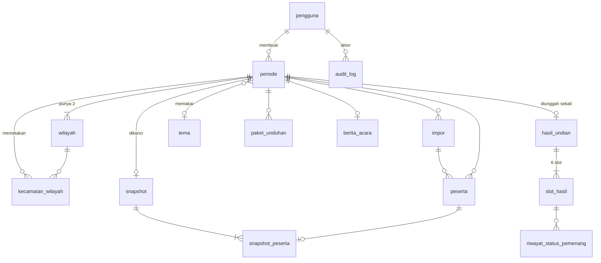

# Database

> Status: Draf v0.1. Sumber kebenaran skema data. Nama model Prisma `PascalCase`, nama tabel/kolom fisik `snake_case` (via `@@map`/`@map`).
> Istilah status & kode mengikuti `PRD.md` §6.0.

## 1. Database Engine

Database:
PostgreSQL 16, diakses lewat Prisma ORM. Migrasi dengan Prisma Migrate.

Hosting:
Container `db` (image resmi `postgres:16`) di Docker Compose pada VPS Pemkab, volume `db-data`. Tidak diekspos ke internet (hanya jaringan internal Compose). Backup harian (`DEPLOYMENT.md`).

---

## 2. Naming Conventions

Tables:
`snake_case`, bentuk tunggal bahasa Indonesia sesuai istilah domain: `pengguna`, `periode`, `peserta`, `audit_log`.

Columns:
`snake_case` di database, `camelCase` di model Prisma (`batasLunas` → `batas_lunas`).

Primary Keys:
`id` bertipe `text` berisi CUID2 (`@default(cuid(2))`), kecuali `audit_log.id` (`bigserial`) dan `snapshot_peserta` (composite, lihat tabel).

Foreign Keys:
`<entitas>_id`, mis. `periode_id`, `pengguna_id`. `ON DELETE RESTRICT` secara default — data undian tidak dihapus berantai.

Timestamps:
`created_at`, `updated_at` bertipe `timestamptz` (Prisma: `@db.Timestamptz(3)`; UTC di DB, ditampilkan WIB). Waktu kejadian spesifik memakai nama `<aksi>_at`, mis. `locked_at`, `uploaded_at`.

Enum:
Nama tipe `PascalCase`, nilai `SCREAMING_SNAKE`, mis. `StatusPeriode.TERKUNCI`. Teks tampilan Indonesia dipetakan di UI.

---

## 3. Tables

### Enum

```prisma
enum Peran          { ADMIN OPERATOR }
enum StatusPeriode  { DRAF TERKUNCI DIUNDI FINAL DIPUBLIKASI DIBATALKAN }
enum KodeWilayah    { W1 W2 }
enum KodeSlot       { W1_UTAMA W1_C1 W1_C2 W2_UTAMA W2_C1 W2_C2 }
enum StatusPemenang { MENANG CADANGAN TERVERIFIKASI GUGUR PERLU_KEPUTUSAN }
enum JenisAset      { AUDIO GAMBAR }
enum FaseAudio      { MENUNGGU MENGACAK PEMENANG }
```

Kode slot di file & UI ditulis dengan strip (`W1-UTAMA`); di DB dengan garis bawah (`W1_UTAMA`). Konversi hanya di `src/lib/draw`.

`PERLU_KEPUTUSAN` dipakai pada tingkat **wilayah** (kolom turunan, lihat `slot_hasil`), bukan per orang — lihat §3 `slot_hasil`.

---

### pengguna

Purpose:
Akun Admin dan Operator.

Columns:
| Kolom | Tipe | Aturan |
|---|---|---|
| `id` | text PK | cuid |
| `username` | text | unik, huruf kecil, 3–32 karakter `[a-z0-9._-]` (CHECK constraint `pengguna_username_format_check`) |
| `nama` | text | wajib |
| `password_hash` | text | argon2id |
| `peran` | `Peran` | wajib |
| `aktif` | boolean | default `true` |
| `must_change_password` | boolean | default `true`; `true` setelah dibuat/di-reset admin |
| `last_login_at` | timestamptz | nullable |
| `version` | int | default 1, `CHECK >= 1`; naik setiap perubahan oleh Admin (optimistic concurrency) |
| `created_at`, `updated_at` | timestamptz | |

---

### periode

Purpose:
Satu penyelenggaraan undian beserta aturannya.

Columns:
| Kolom | Tipe | Aturan |
|---|---|---|
| `id` | text PK | |
| `slug` | text | unik, `undian-umroh-<tahun_akhir>`; bila sudah dipakai (mis. periode dibatalkan) diberi akhiran `-2`, `-3`, …; tidak berubah saat judul diubah (dipakai nama file paket) |
| `judul` | text | wajib, default "Undian Umroh Wajib Pajak PBB-P2 OKU Selatan Tahun 2026" |
| `tahun_awal` | int | 2022 |
| `tahun_akhir` | int | 2026 |
| `batas_lunas` | timestamptz | wajib; nilai bawaan `2026-09-30T23:59:59+07:00` diisi aplikasi (`BATAS_LUNAS_BAWAAN`), bukan default DB, agar tidak bergantung zona waktu server |
| `tanggal_acara` | date | nullable |
| `lokasi_acara` | text | nullable, maks. 150 karakter |
| `status` | `StatusPeriode` | default `DRAF` |
| `tema_id` | text FK → `tema.id` | nullable (null = tema default) |
| `published_at` | timestamptz | nullable |
| `alasan_batal` | text | wajib (≥ 10 karakter) jika `DIBATALKAN` — CHECK `periode_alasan_batal_check` |
| `version` | int | default 1, `CHECK >= 1`, naik setiap update termasuk ubah nama wilayah (optimistic concurrency) |
| `created_by_id` | text FK → `pengguna.id` | |
| `created_at`, `updated_at` | timestamptz | |

---

### wilayah

Purpose:
Dua wilayah per periode.

Columns:
| Kolom | Tipe | Aturan |
|---|---|---|
| `id` | text PK | |
| `periode_id` | text FK | |
| `kode` | `KodeWilayah` | unik bersama `periode_id` |
| `nama` | text | bawaan "Wilayah 1" / "Wilayah 2" (diisi aplikasi); 1–50 karakter (CHECK `wilayah_nama_check`) |

Dibuat otomatis (2 baris) saat periode dibuat.

---

### kecamatan_wilayah

Purpose:
Pemetaan kecamatan (hasil normalisasi) ke wilayah.

Columns:
| Kolom | Tipe | Aturan |
|---|---|---|
| `id` | text PK | |
| `periode_id` | text FK | |
| `kecamatan` | text | nilai hasil `normalizeKecamatan`; unik bersama `periode_id` |
| `wilayah_id` | text FK → `wilayah.id` | nullable = belum dipetakan |

Baris dibuat/diperbarui otomatis setelah impor untuk setiap kecamatan yang muncul. Pemetaan yang sudah ada dipertahankan saat impor ulang.

---

### impor

Purpose:
Riwayat dan ringkasan setiap impor.

Columns:
| Kolom | Tipe | Aturan |
|---|---|---|
| `id` | text PK | |
| `periode_id` | text FK | |
| `nama_file` | text | |
| `file_sha256` | text | hash file mentah |
| `total_baris` | int | |
| `jumlah_lolos` | int | |
| `jumlah_gugur` | int | |
| `ringkasan` | jsonb | `{ gugurPerAlasan: { KODE: jumlah }, nikTidakValid: n, nopGanda: n, lolosPerKecamatan: { KECAMATAN: jumlahLolos } }`; `nopGanda` = jumlah NOP berbeda yang muncul > 1 kali. jsonb tidak menjaga urutan kunci, jadi layanan mengurutkan ulang saat membaca |
| `aktif` | boolean | hanya impor terakhir `true` — index unik parsial `impor_satu_aktif` (`WHERE aktif`) |
| `imported_by_id` | text FK | |
| `created_at` | timestamptz | |

---

### peserta

Purpose:
Setiap baris data impor (lolos maupun gugur) untuk impor aktif periode.

Columns:
| Kolom | Tipe | Aturan |
|---|---|---|
| `id` | text PK | |
| `periode_id` | text FK | |
| `impor_id` | text FK | |
| `baris` | int | nomor baris di file (header = 1) |
| `nop` | text | 18 digit hasil normalisasi; jika tidak valid disimpan nilai mentah ter-trim |
| `nik_enc` | bytea | nullable; NIK mentah ter-trim terenkripsi AES-256-GCM (§10), juga bila tidak valid; null bila sel kosong |
| `nik_masked` | text | `1609xxxxxxxx0012`, atau `-` jika tidak valid |
| `nik_valid` | boolean | 16 digit angka |
| `nama` | text | |
| `alamat_wp` | text | boleh kosong |
| `alamat_op` | text | boleh kosong |
| `kecamatan_raw` | text | nilai ter-trim apa adanya |
| `kecamatan` | text | hasil `normalizeKecamatan` |
| `kelurahan` | text | boleh kosong |
| `lunas_2022` … `lunas_2026` | timestamptz | nullable (null = kosong/tidak terbaca) |
| `lunas_raw` | jsonb | `{ "2022": "29/06/2022 14:14:36", ... }` nilai asli untuk audit |
| `eligible` | boolean | hasil `evaluateEligibility` |
| `alasan` | text[] | kode alasan gugur; kosong jika lolos |
| `created_at` | timestamptz | |

Catatan: kolom tahun di-hardcode untuk 2022–2026 sesuai periode pertama. Periode dengan rentang tahun berbeda membutuhkan migrasi ke tabel `pelunasan` (dicatat di `ROADMAP.md` LATER).

---

### snapshot

Purpose:
Bukti penguncian daftar peserta lolos.

Columns:
| Kolom | Tipe | Aturan |
|---|---|---|
| `id` | text PK | |
| `periode_id` | text FK | unik (satu snapshot per periode) |
| `hash` | text | SHA-256 hex huruf kecil (64) dari `snapshot.json` kanonik |
| `jumlah_w1` | int | |
| `jumlah_w2` | int | |
| `file_path` | text | relatif terhadap `/data/storage`, mis. `snapshot/<periodeId>.json` |
| `locked_by_id` | text FK | |
| `locked_at` | timestamptz | |

---

### snapshot_peserta

Purpose:
Indeks peserta yang terkunci, untuk verifikasi hasil dan halaman publik tanpa membaca file.

Columns:
| Kolom | Tipe | Aturan |
|---|---|---|
| `snapshot_id` | text FK | PK komposit (`snapshot_id`, `urut`) |
| `urut` | int | 1..N, urutan NOP naik; ID peserta di paket & hasil |
| `peserta_id` | text FK → `peserta.id` | unik |
| `nop` | text | unik bersama `snapshot_id` |
| `wilayah` | `KodeWilayah` | |

---

### hasil_undian

Purpose:
File hasil yang diterima dan lolos verifikasi.

Columns:
| Kolom | Tipe | Aturan |
|---|---|---|
| `id` | text PK | |
| `periode_id` | text FK | **unik** — menjamin unggah sekali |
| `hasil_hash` | text | dari file, sudah diverifikasi |
| `snapshot_hash` | text | salinan untuk bukti |
| `isi` | jsonb | isi file hasil apa adanya |
| `dimulai_at`, `selesai_at` | timestamptz | dari file |
| `uploaded_by_id` | text FK | |
| `uploaded_at` | timestamptz | |

---

### slot_hasil

Purpose:
Enam slot pemenang dan status terkini.

Columns:
| Kolom | Tipe | Aturan |
|---|---|---|
| `id` | text PK | |
| `hasil_id` | text FK | |
| `periode_id` | text FK | (denormalisasi untuk query) |
| `slot` | `KodeSlot` | unik bersama `periode_id` |
| `urutan` | int | 1..6 |
| `wilayah` | `KodeWilayah` | |
| `snapshot_urut` | int | → `snapshot_peserta.urut` |
| `peserta_id` | text FK | unik bersama `periode_id` |
| `diundi_at` | timestamptz | dari file |
| `status` | `StatusPemenang` | awal: `MENANG` untuk `*_UTAMA`, `CADANGAN` untuk C1/C2 |
| `penerima_aktif` | boolean | tepat satu `true` per wilayah, kecuali wilayah perlu keputusan |
| `alasan_gugur` | text | nullable; pilihan: `TIDAK_DAPAT_DIHUBUNGI`, `MENGUNDURKAN_DIRI`, `DATA_TIDAK_VALID`, `LAINNYA` |
| `catatan` | text | nullable; wajib jika `GUGUR` |
| `status_changed_by_id` | text FK | nullable |
| `status_changed_at` | timestamptz | nullable |
| `version` | int | optimistic concurrency |
| `foto_dokumentasi` | text[] | array ID aset bukti penyerahan hadiah secara simbolis (maks. 3 foto) |
| `diserahkan_at` | timestamptz | nullable; waktu penyerahan hadiah simbolis |
| `diserahkan_catatan` | text | nullable; catatan / keterangan serah terima simbolis |

Status wilayah `PERLU_KEPUTUSAN` diturunkan: ketiga slot wilayah berstatus `GUGUR`. Agar query publik sederhana, slot terakhir yang gugur tidak diubah; layanan menghitung status wilayah dan mengembalikannya sebagai `statusWilayah`.

---

### riwayat_status_pemenang

Purpose:
Jejak setiap perubahan status slot (selain audit log umum) untuk berita acara.

Columns:
`id`, `slot_hasil_id` FK, `dari` `StatusPemenang`, `ke` `StatusPemenang`, `alasan_gugur`, `catatan`, `oleh_id` FK, `at` timestamptz.

---

### tema

Purpose:
Konfigurasi tampilan & suara Layar Undian.

Columns:
| Kolom | Tipe | Aturan |
|---|---|---|
| `id` | text PK | |
| `nama` | text | |
| `config` | jsonb | `ThemeConfig` tervalidasi (`API.md` §5) |
| `config_hash` | text | SHA-256 kanonik config |
| `sumber` | text | `MANUAL` atau `AI` |
| `bawaan` | boolean | tema default tidak dapat dihapus |
| `created_by_id`, `updated_by_id` | text FK | |
| `created_at`, `updated_at` | timestamptz | |

---

### aset

Purpose:
Metadata file audio dan gambar (file di `/data/storage/aset/`).

Columns:
| Kolom | Tipe | Aturan |
|---|---|---|
| `id` | text PK | dipakai di `ThemeConfig` |
| `jenis` | `JenisAset` | |
| `fase` | `FaseAudio` | nullable; saran fase untuk audio |
| `nama` | text | nama tampilan |
| `deskripsi` | text | dipakai sebagai katalog untuk AI, mis. "rebana pelan, tempo 80 bpm" |
| `mime` | text | `audio/mpeg`, `audio/ogg`, `image/png`, `image/jpeg`, `image/webp` |
| `ukuran` | int | byte |
| `sha256` | text | unik; nama file `<sha256>.<ext>` |
| `durasi_detik` | numeric | nullable (audio) |
| `lisensi` | text | wajib untuk aset bawaan |
| `bawaan` | boolean | |
| `created_by_id` | text FK | nullable untuk bawaan |
| `created_at` | timestamptz | |

---

### paket_unduhan

Purpose:
Riwayat unduhan paket (bukti versi tema yang dipakai di acara).

Columns:
`id`, `periode_id` FK, `snapshot_hash`, `tema_config_hash`, `paket_sha256`, `unduh_by_id` FK, `created_at`.

---

### berita_acara

Purpose:
Field teks berita acara yang dapat diedit.

Columns:
`id`, `periode_id` FK unik, `isi` jsonb (`nomor`, `tempat`, `hariTanggal`, `dasarKegiatan`, `panitia[]{nama,jabatan}`, `saksi[]{nama,instansi}`), `updated_by_id` FK, `updated_at`.

---

### audit_log

Purpose:
Jejak semua aksi penting. **Append-only.**

Columns:
| Kolom | Tipe | Aturan |
|---|---|---|
| `id` | bigserial PK | |
| `at` | timestamptz | default `now()` |
| `aktor_id` | text FK | nullable (aksi publik/sistem/login gagal) |
| `aktor_label` | text | username atau `publik`/`sistem` |
| `aksi` | text | kode, mis. `PERIODE_KUNCI` (daftar di `OBSERVABILITY.md`) |
| `target_tipe` | text | mis. `periode`, `slot_hasil` |
| `target_id` | text | nullable |
| `payload` | jsonb | ringkas, tanpa data sensitif (NIK utuh, kata sandi, token dilarang) |
| `ip` | inet | nullable |
| `user_agent` | text | nullable, maks. 256 karakter |

### Diagram ER



---

## 4. Relationships

- `periode` → `wilayah`: satu periode tepat dua wilayah (W1, W2).
- `periode` → `kecamatan_wilayah` → `wilayah`: satu kecamatan maksimal satu wilayah per periode.
- `periode` → `impor` → `peserta`: satu periode banyak impor; hanya impor `aktif` yang punya baris `peserta` (impor ulang menghapus peserta impor lama).
- `periode` → `snapshot` (0..1) → `snapshot_peserta` (1..N) → `peserta`.
- `periode` → `hasil_undian` (0..1) → `slot_hasil` (tepat 6) → `riwayat_status_pemenang`.
- `periode` → `tema` (0..1); `tema.config` mereferensikan `aset.id`.
- `pengguna` → hampir semua tabel sebagai aktor.

---

## 5. Constraints

Required:
- `pengguna.username`, `pengguna.password_hash`, `pengguna.peran`
- `periode.judul`, `periode.batas_lunas`, `periode.status`
- `peserta.periode_id`, `peserta.baris`, `peserta.nop`, `peserta.eligible`
- `snapshot.hash`, `hasil_undian.hasil_hash`, `slot_hasil.slot`, `slot_hasil.status`

Unique:
- `pengguna.username`
- `periode.slug`
- `wilayah (periode_id, kode)`
- `kecamatan_wilayah (periode_id, kecamatan)`
- `snapshot.periode_id`
- `snapshot_peserta (snapshot_id, urut)`, `(snapshot_id, nop)`, `peserta_id`
- `hasil_undian.periode_id`
- `slot_hasil (periode_id, slot)`, `(periode_id, peserta_id)`
- `aset.sha256`
- `berita_acara.periode_id`
- Partial unique: hanya satu `periode` aktif (status selain `DIPUBLIKASI` dan `DIBATALKAN`). SQL di migrasi: `CREATE UNIQUE INDEX periode_satu_aktif ON periode ((true)) WHERE status NOT IN ('DIPUBLIKASI', 'DIBATALKAN');`
- `DIBATALKAN` hanya dapat dicapai dari `DRAF` atau `TERKUNCI` (belum ada hasil), wajib alasan, dan bersifat final. Dipakai bila data terkunci ternyata salah sehingga perlu periode baru.

Foreign Keys:
- Semua `*_id` merujuk tabel sesuai nama; `ON DELETE RESTRICT`.
- Pengecualian: `peserta.impor_id` `ON DELETE CASCADE` (hapus impor lama menghapus pesertanya, hanya saat Draf).

Catatan: `peserta.nop` **tidak** unik — NOP ganda harus tersimpan agar bisa dilaporkan. Keunikan dijamin di `snapshot_peserta`.

---

## 6. Indexes

Index:
`peserta (periode_id, eligible)`
Reason:
Ringkasan dan filter status di laporan.

Index:
`peserta (periode_id, kecamatan)`
Reason:
Pemetaan wilayah dan filter kecamatan.

Index:
`peserta (periode_id, nop)`
Reason:
Deteksi ganda, pencarian admin, `/cek` publik.

Index:
`peserta` GIN pada `alasan`
Reason:
Filter berdasarkan kode alasan.

Index:
`peserta (periode_id, nama)` (btree biasa; `text_pattern_ops` tidak dipakai karena Prisma tidak dapat membacanya balik sehingga selalu terdeteksi drift)
Reason:
Pencarian awalan nama di tabel admin (tiket 06 menilai ulang bila perlu).

Index:
`audit_log (at DESC)`, `audit_log (aksi, at DESC)`, `audit_log (aktor_id, at DESC)`
Reason:
Filter log audit.

---

## 7. Data Validation

- Semua validasi format dilakukan di aplikasi (zod + `src/lib/domain`) sebelum menulis; DB menegakkan constraint struktural.
- Transisi status periode hanya lewat service `periode.transition(id, dari, ke, version)` dengan `UPDATE ... WHERE status = :dari AND version = :version`; 0 baris terdampak → error `CONFLICT`.
- Tabel `peserta`, `kecamatan_wilayah`, `periode.batas_lunas` hanya boleh berubah saat `status = DRAF`.
- `snapshot`, `snapshot_peserta`, `hasil_undian` **immutable**: tidak ada UPDATE/DELETE di kode aplikasi. Trigger PostgreSQL `BEFORE UPDATE OR DELETE` menolak perubahan (dibuat di migrasi).
- `audit_log` append-only: trigger menolak UPDATE/DELETE (per baris) dan TRUNCATE (per pernyataan) lewat fungsi `tolak_ubah_tabel_immutable()` yang dipakai ulang oleh tabel immutable lain. Tes membuat akun dengan username acak dan tidak menghapus data; pembersihan massal di tes memakai `session_replication_role = replica`.
- Tabel yang sudah ada di skema: `pengguna`, `audit_log` (tiket 02), `periode`, `wilayah` (tiket 04), `impor`, `peserta` (tiket 05), `kecamatan_wilayah` (tiket 08; `wilayah_id` selalu wilayah periode yang sama, dijaga layanan); tabel lain menyusul bersama tiket pemiliknya. Kolom `periode.tema_id` ditambahkan oleh tiket tema.
- Pembuatan periode memakai `pg_advisory_xact_lock(hashtext('periode:satu-aktif'))` agar dua permintaan bersamaan diproses bergiliran dengan pesan `PERIODE_AKTIF_SUDAH_ADA` yang jelas; index `periode_satu_aktif` tetap penjaga terakhir.
- `slot_hasil`: hanya kolom status yang boleh berubah, lewat service pemenang dengan `version`.

---

## 8. Soft Delete

Does the system use soft deletion?
Sebagian.

If yes:
- `pengguna`: tidak dihapus, dinonaktifkan (`aktif = false`).
- `aset`: dapat dihapus permanen jika tidak dipakai tema mana pun dan bukan bawaan.
- `tema`: dapat dihapus jika tidak dipakai periode mana pun dan bukan bawaan.
- `periode` dan seluruh turunannya: tidak dihapus dari aplikasi. Retensi data pribadi diatur di §10 dan `SECURITY.md` §6.

---

## 9. Auditing

Do we record:
- Created by? Ya (`created_by_id`, `imported_by_id`, `locked_by_id`, `uploaded_by_id`).
- Updated by? Ya untuk tema, berita acara, status pemenang.
- Deleted by? Ya, lewat `audit_log` (aset/tema).
- Activity history? Ya, `audit_log` + `riwayat_status_pemenang`.

Aturan:
- Setiap mutasi yang tercantum di PRD F11 menulis satu baris `audit_log` di **transaksi yang sama** dengan perubahan datanya.
- Payload audit berisi ID dan ringkasan (mis. `{ "jumlahBaris": 45812, "fileSha256": "…" }`), bukan data peserta.
- Daftar kode aksi di `OBSERVABILITY.md`.

---

## 10. Sensitive Data

Sensitive fields:
- `peserta.nik_enc` (NIK)
- `peserta.nama`, `alamat_wp`, `alamat_op` (data pribadi; boleh tampil sesuai PRD, tetapi tetap dilindungi akses massal)
- `peserta.nop` utuh (tampil utuh hanya untuk admin)
- `pengguna.password_hash`
- `audit_log.ip`

Protection:
- NIK dienkripsi AES-256-GCM di aplikasi dengan kunci `NIK_ENCRYPTION_KEY` (32 byte, base64) sebelum disimpan; format `bytea` = `iv(12) || ciphertext || tag(16)`. Hanya `nik_masked` yang dipakai untuk tampilan.
- Dekripsi hanya di service `pemenang.tampilkanNik` (admin, kandidat pemenang saja, tercatat di audit).
- `snapshot.json`, paket, file hasil, halaman publik, dan respons API publik **tidak pernah** memuat `nik_enc`, NIK utuh, atau NOP utuh.
- Query publik (`/cek`) hanya memilih kolom yang diperlukan (`select` eksplisit), tidak pernah `SELECT *`.
- Akses DB hanya dari container aplikasi; kredensial DB di env.

---

## 11. Migration Rules

Schema changes must:
1. Be documented (perbarui dokumen ini + `CHANGELOG.md`)
2. Have a migration (`prisma migrate dev --name <deskripsi_snake_case>`; trigger & index parsial ditulis SQL manual di file migrasi)
3. Be tested (test integrasi berjalan di DB hasil migrasi)
4. Avoid breaking existing production data (tambah kolom nullable/berdefault dulu, backfill, baru jadikan wajib)

Tambahan:
- Produksi hanya menjalankan `prisma migrate deploy` (tidak pernah `migrate dev`/`db push`).
- Backup DB wajib sebelum migrasi produksi.
- Dilarang mengubah migrasi yang sudah diterapkan di produksi.

---

## 12. Seed Data

- **Produksi** (`npm run db:seed`): satu akun Admin dari env `SEED_ADMIN_USERNAME`, `SEED_ADMIN_PASSWORD` (wajib diganti saat login pertama — lihat `SECURITY.md`); aset bawaan dari `public/aset-bawaan/` (metadata + lisensi); tema default "Slot Mesin Bawaan". Idempoten.
- **Pengembangan** (`npm run db:seed:dev`): tambahan akun `operator.demo`, satu periode Draf dengan data dari `tests/fixtures/peserta-dummy.csv` (data dummy, bukan data asli), pemetaan contoh kecamatan ke wilayah.
- Data asli wajib pajak **tidak boleh** dipakai di seed, fixture, atau repositori.
