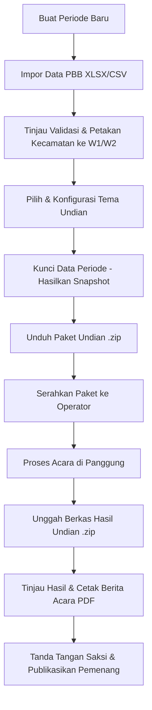

# Panduan Operasional Sistem Undian Umroh PBB-P2

> Bapenda Kabupaten OKU Selatan — Tahun Anggaran 2026
> Bahasa: Indonesia | Status: Panduan Resmi Operasional

---

## 1. Peran dan Tanggung Jawab

| Peran | Tanggung Jawab Utama | Akses Sistem |
|---|---|---|
| **Admin** | Mengelola periode, mengimpor data PBB, memetakan wilayah, mengunci data peserta, menyusun berita acara, mempublikasikan pemenang. | Dasbor Admin Web (`/admin`) |
| **Operator** | Mengunduh paket undian, menjalankan aplikasi undian offline di panggung acara, mengoperasikan layar undian per slot, mengekspor dan mengunggah hasil undian. | Layar Undian (`/undian`), Tab Hasil & Paket |
| **Saksi & Notaris** | Memverifikasi integritas data, menyaksikan proses pengacakan, menandatangani Berita Acara resmi. | Verifikasi fisik & tanda tangan BA |

---

## 2. Alur Kerja Admin (Persiapan & Penutupan)

1. **Pembuatan Periode**: Masuk ke `/admin/periode`, buat periode baru dengan judul, tanggal acara, lokasi, dan saksi.
2. **Impor Data**: Unggah berkas data PBB (`.xlsx` atau `.csv`). Sistem memvalidasi kriteria kelulusan (lunas 5 tahun berturut-turut, keabsahan NIK, keunikan NOP).
3. **Pemetaan Wilayah**: Petakan seluruh kecamatan yang lolos ke Wilayah 1 (W1) atau Wilayah 2 (W2).
4. **Pemilihan Tema**: Buka `/admin/tema`, pilih tema aktif dan pratinjau audio/animasi.
5. **Penguncian Data (Freeze)**: Setelah diverifikasi bersama pimpinan, lakukan **Kunci Data**. Snapshot kanonik dibuat dan menjadi tidak dapat diubah (immutable).
6. **Unduh Paket**: Ambil berkas `paket-undian-[slug]-[hash].zip` untuk diserahkan ke laptop acara.

---

## 3. Alur Kerja Operator (Hari-H di Panggung)

1. **Persiapan Laptop Acara**:
   - Gunakan laptop yang telah terpasang peramban modern (Chrome/Edge/Firefox).
   - Akses antarmuka undian di URL `/operator/undian` (atau klik menu **Layar Undian** di panel operator).
   - **Koneksi Jaringan**: Sistem berjalan 100% di sisi klien (*client-side*). Aplikasi **tetap berjalan lancar baik saat ada koneksi internet/Wi-Fi maupun tanpa internet (offline)**. Memutuskan jaringan internet bersifat anjuran tata kelola (air-gapped) untuk meyakinkan saksi/notaris, bukan pembatas teknis sistem.
   - Sambungkan laptop ke proyektor resolusi 16:9 dan sistem audio panggung.
2. **Memuat Paket Undian**:
   - Di halaman `/operator/undian`, klik kotak **"Pilih file paket .zip"** dan pilih berkas `paket-undian-[slug]-[hash].zip` yang sudah diunduh (**berkas ZIP tidak perlu diekstrak manual**).
   - Peramban secara otomatis membaca isi ZIP di memori, memverifikasi hash SHA-256 manifes, dan menyimpan data peserta ke IndexedDB lokal peramban.
3. **Uji Coba Visual & Audio**:
   - Jalankan uji audio (musik latar menunggu, efek undian berputar, gong pemenang).
   - Pastikan nama wilayah (W1 dan W2) dan slot hadiah tampil jelas di layar proyektor.
4. **Proses Pengundian**:
   - Setiap slot diundi secara berurutan: Slot 1 (W1), Slot 2 (W2), dst.
   - Tombol "Mulai Undi" memicu putaran acak. Tombol "Stop" mengunci pemenang terpilih.
   - Pemenang langsung ditampilkan di kartu pemenang dengan NIK termasker (`1609xxxxxxxx0001`).
5. **Ekspor Hasil**:
   - Setelah semua slot selesai diundi, klik tombol **Ekspor Paket Hasil**.
   - Simpan berkas `hasil-undian-[slug]-[timestamp].zip` ke media penyimpanan terenkripsi/flashdisk panitia.

---

## 4. Checklist Waktu Pelaksanaan

### H-14 (Dua Minggu Sebelum Acara)
- [ ] Data PBB final dari Bapenda telah diimpor ke sistem.
- [ ] Laporan validasi ditinjau: total baris, jumlah lolos, jumlah gugur per kecamatan.
- [ ] Pemetaan kecamatan ke Wilayah 1 dan Wilayah 2 diverifikasi.

### H-7 (Satu Minggu Sebelum Acara)
- [ ] Daftar saksi resmi, notaris, dan kepolisian dikonfirmasi.
- [ ] Kunjungan lokasi acara: tes proyeksi 16:9 dan keluaran audio panggung.
- [ ] Uji pemulihan backup database (`scripts/restore.sh`) berhasil dilaksanakan di server staging.
- [ ] **Gladi Bersih Penuh**: simulasi pengundian menggunakan data dummy di laptop acara tanpa internet.

### H-1 (Satu Hari Sebelum Acara)
- [ ] Data periode dikunci (**Kunci Data**) oleh Admin.
- [ ] Paket undian final diunduh ke Laptop Utama dan Laptop Cadangan.
- [ ] Matikan Wi-Fi, Bluetooth, dan koneksi internet pada kedua laptop acara.
- [ ] Pastikan daya baterai dan charger laptop dalam kondisi prima.

### Hari-H (Saat Acara Berlangsung)
- [ ] Berita Acara pembukaan diperiksa bersama saksi.
- [ ] Pengundian dilaksanakan per slot di panggung secara tertib.
- [ ] Paket hasil undian diekspor dan dicadangkan ganda.
- [ ] Berita Acara PDF dicetak dan ditandatangani basah oleh para saksi.

### Pasca Acara (Setelah Selesai)
- [ ] Paket hasil diunggah oleh Admin ke server melalui `/admin/periode/[id]/hasil`.
- [ ] Status periode diubah menjadi **Dipublikasikan**.
- [ ] Publik dapat mengecek daftar pemenang di `/pemenang` dan NOP di `/cek`.
- [ ] **Pembersihan Data Laptop**: Lakukan pembersihan wajib pada laptop panggung (lihat Bagian 6).

---

## 5. Prosedur Penanganan Gangguan (Troubleshooting)

### A. Laptop Panggung Mati / Korsleting Listrik
1. Tetap tenang; jangan panik.
2. Alihkan proyektor dan audio ke **Laptop Cadangan**.
3. Muat kembali paket undian di laptop cadangan.
4. Jika sebagian slot sudah diundi sebelum laptop mati, masukkan slot hasil yang sudah tercatat pada catatan saksi atau lanjutkan slot berikutnya sesuai kesepakatan panitia dan saksi.

### B. Kegagalan Database di Server VPS
1. Periksa kontainer dengan `docker compose ps`.
2. Jika database berhenti mendadak, periksa log dengan `docker compose logs --tail 100 db`.
3. Jalankan `scripts/watch.sh` untuk melihat indikasi disk penuh atau memori habis.
4. Jika data rusak: pulihkan backup terenkripsi terakhir dengan `scripts/restore.sh`.

---

## 6. Prosedur Wajib Pembersihan Data Laptop (Data Sanitization)

Sesuai aturan keamanan data pribadi (SECURITY §6, UU PDP):
1. Berkas paket undian `.zip` dan file sementara di laptop acara tidak boleh tertinggal.
2. Setelah paket hasil berhasil diekspor dan dicadangkan ke server VPS, lakukan:
   - Hapus berkas paket undian dan hasil dari folder Downloads/Desktop.
   - Kosongkan Recycle Bin / Trash secara permanen.
   - Bersihkan cache, IndexedDB, dan Local Storage pada peramban yang digunakan.
3. Panitia menandatangani lembar serah terima laptop yang menyatakan laptop telah bersih dari data sensitif wajib pajak.

---

## 7. Pengelolaan Kunci Rahasia dan Enkripsi

- Kunci privat `age` (untuk membuka backup terenkripsi) dan `NIK_ENCRYPTION_KEY` **DILARANG KERAS** disimpan di dalam server VPS produksi atau di repositori git.
- Kunci-kunci tersebut harus disimpan di media fisik terpisah (flashdisk terenkripsi) yang disimpan di brankas fisik milik Kepala Bidang PBB / Diskominfo OKU Selatan.
- Server hanya menyimpan kunci publik `BACKUP_AGE_RECIPIENT` untuk mengenkripsi backup harian.
