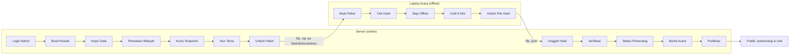
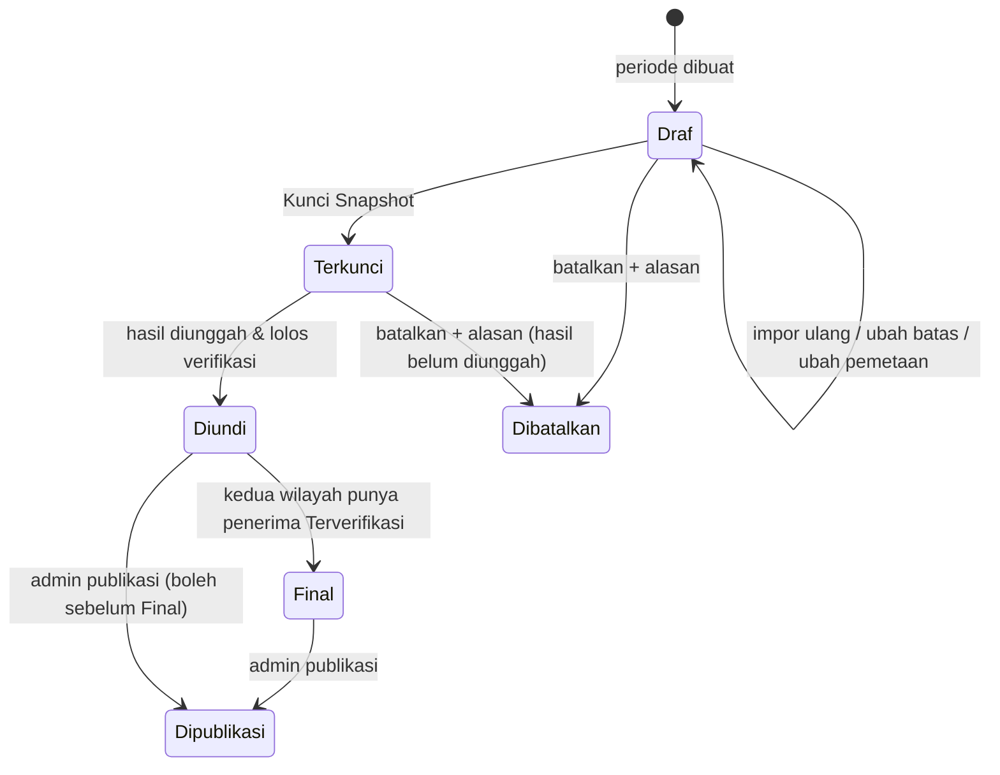
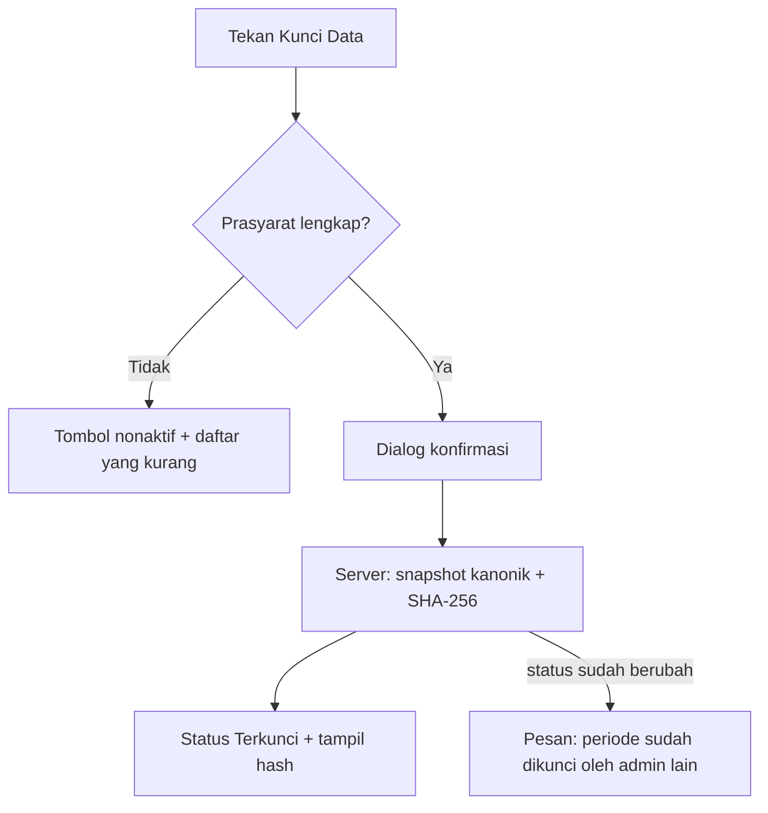
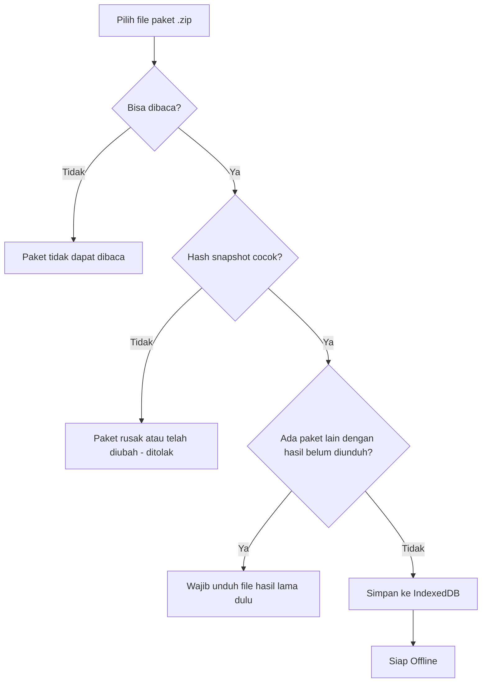
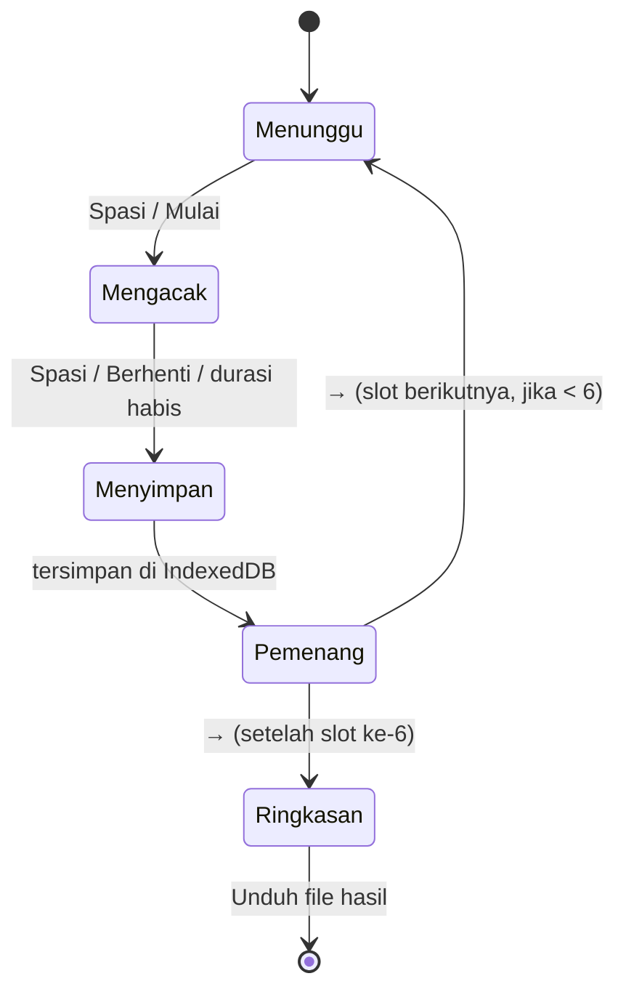
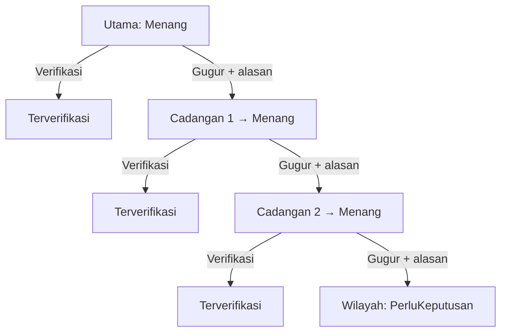

# UX Flows

> Status: Draf v0.1. Turunan dari `PRD.md`. Setiap flow mencantumkan fitur PRD yang dicakup.
> Kode alasan gugur, kode slot, dan status mengikuti PRD §6.0.

## Peta Flow

| Flow | Peran | Fitur PRD |
|---|---|---|
| 1 — Login (pengganti User Registration) | Admin, Operator | F11 |
| 2 — Buat Periode (pengganti Create Project) | Admin | F2 |
| 3 — Impor Data & Laporan Validasi | Admin | F1 |
| 4 — Pemetaan Kecamatan ke Wilayah | Admin | F2 |
| 5 — Kunci Snapshot | Admin | F3 |
| 6 — Atur Tema & Asisten AI | Admin | F6 |
| 7 — Unduh Paket Undian | Admin | F4 |
| 8 — Muat Paket di Laptop Acara | Operator | F4 |
| 9 — Menjalankan Undian (Hari-H) | Operator | F5 |
| 10 — Pemulihan Setelah Refresh/Crash | Operator | F5 |
| 11 — Unggah & Verifikasi Hasil | Operator, Admin | F7 |
| 12 — Verifikasi Pemenang & Cadangan Naik | Admin | F8 |
| 13 — Berita Acara & Ekspor | Admin | F9 |
| 14 — Publikasi & Halaman Pemenang | Admin, Publik | F10 |
| 15 — Cek NOP | Publik | F10 |
| 16 — Kelola Akun & Log Audit | Admin | F11 |
| 17 — Flow Error Lintas Fitur | Semua | F1–F7 |

### Gambaran Besar (Online & Offline)

### Siklus Status Periode

---

## Flow 1 — User Registration

Tidak berlaku — tidak ada pendaftaran mandiri. Akun dibuat oleh Admin (Flow 16). Flow ini diganti **Login**.

1. Pengguna membuka `/login`
2. Mengisi username dan kata sandi
3. Menekan "Masuk"
4. Server memvalidasi kredensial dan status akun aktif
5. Sesi dibuat
6. Admin diarahkan ke `/admin` (dasbor periode); Operator ke `/operator` (layar undian & unggah hasil)

Success:
Pengguna masuk ke halaman sesuai peran. Login tercatat di log audit.

Failure:
- Kredensial salah → pesan "Username atau kata sandi salah." (tanpa menyebut mana yang salah). Tercatat sebagai login gagal.
- Akun nonaktif → pesan sama dengan kredensial salah.
- 5 percobaan gagal dalam 15 menit dari IP/username yang sama → login dikunci 15 menit dengan pesan "Terlalu banyak percobaan. Coba lagi dalam 15 menit."
- Operator membuka URL `/admin/*` → diarahkan ke `/operator` dengan pesan "Anda tidak memiliki akses ke halaman ini."

Loading State:
Tombol "Masuk" menampilkan spinner dan nonaktif.

---

## Flow 2 — Create Project

Diterjemahkan menjadi **Buat Periode Undian**.

1. Admin menekan "Buat Periode" di dasbor
2. Formulir terbuka
3. Admin mengisi judul (default "Undian Umroh Wajib Pajak PBB-P2 OKU Selatan Tahun 2026"), tahun pajak (2022–2026, tetap), tanggal batas (default 30/09/2026 23:59:59 WIB), tanggal & lokasi acara (opsional), nama tampilan Wilayah 1 & 2
4. Admin menekan "Simpan"
5. Server memvalidasi (judul wajib, tanggal batas valid, hanya satu periode aktif)
6. Periode dibuat dengan status Draf
7. Admin diarahkan ke halaman periode, tab "Data Peserta" (sebelum tab tersedia: halaman ringkasan periode `/admin/periode/:id` berisi Pengaturan Periode, form Ubah Periode, dan Batalkan Periode)

Catatan implementasi (tiket 04):
- Dasbor dan menu "Periode" (`/admin/periode`) menampilkan daftar periode berchip status. Selama ada periode aktif, tombol "Buat Periode" diganti keterangan alasannya.
- Tanggal batas dipilih sebagai tanggal; berlaku sampai 23:59:59 WIB. Setelah Terkunci field ini nonaktif dengan alasan.
- Batalkan Periode: tombol bahaya → konfirmasi sebaris dengan alasan wajib (10–500 karakter) → "Ya, batalkan periode". Periode Dibatalkan menampilkan banner alasan dan tidak dapat diubah.
- Operator melihat daftar periode di `/operator` dan detail baca-saja di `/operator/periode/:id`.

Loading State:
Tombol "Simpan" spinner dan nonaktif.

Error State:
- Field tidak valid → pesan di bawah field terkait.
- Sudah ada periode aktif (belum Dipublikasi) → "Masih ada periode aktif: <judul>. Publikasikan atau batalkan periode tersebut dulu."

Empty State:
Dasbor tanpa periode → ilustrasi sederhana, teks "Belum ada periode undian", tombol "Buat Periode".

---

## Flow 3 — Impor Data & Laporan Validasi

1. Admin membuka periode (status Draf), tab "Data Peserta"
2. Menekan "Unggah File", memilih `.csv` atau `.xlsx` (maks. 20 MB)
3. Jika periode sudah punya data → dialog "Impor ulang akan mengganti seluruh data peserta periode ini. Lanjutkan?"
4. File diunggah; progress bar menampilkan tahap: Mengunggah → Membaca header → Memproses baris (n / total) → Menyimpan
5. Server memvalidasi header 12 kolom; jika salah → berhenti (lihat Error)
6. Setiap baris dievaluasi sesuai PRD §6.0
7. Laporan tampil

Isi laporan:
- Kartu ringkasan: Total baris · Lolos (Wilayah 1 / Wilayah 2 / belum terpetakan) · Gugur · NOP ganda · Peringatan NIK
- Tabel "Gugur per alasan" (kode + pesan + jumlah)
- Banner kuning jika ada kecamatan belum terpetakan, dengan tautan ke Flow 4
- Tabel peserta: kolom NOP (bertitik, utuh untuk admin), NIK (tersamar), nama, kecamatan, kelurahan, 5 tanggal lunas, status, alasan. Filter: status, wilayah, kecamatan, alasan. Pencarian: NOP atau nama. Paginasi 50 baris.
- Tombol "Ekspor Daftar Gugur (Excel)"

Loading State:
Progress bar bertahap; halaman tidak boleh ditutup (peringatan `beforeunload`). Tombol unggah nonaktif.

Error State:
- Header salah → "Header file tidak sesuai. Kolom hilang: Tanggal Lunas 2024. Kolom tidak dikenal: TGL_2024." Tidak ada data tersimpan.
- File > 20 MB / format lain → "File harus .csv atau .xlsx, maksimal 20 MB."
- Encoding tidak terbaca → "File tidak dapat dibaca. Simpan ulang sebagai CSV UTF-8."
- Periode tidak Draf → tombol unggah tidak tampil; jika dipaksa lewat API → "Periode sudah terkunci. Data tidak dapat diubah."

Empty State:
"Belum ada data peserta. Unggah file ekspor PBB (CSV pemisah titik koma atau XLSX)." + tautan unduh contoh format header.

Success:
Toast "Impor selesai: 45.812 baris, 41.230 lolos, 4.582 gugur." (angka ilustrasi). Tercatat di log audit.

---

## Flow 4 — Pemetaan Kecamatan ke Wilayah

1. Admin membuka tab "Wilayah"
2. Daftar kecamatan (hasil normalisasi dari data impor) tampil dengan jumlah NOP lolos per kecamatan
3. Setiap baris punya pilihan berbentuk tombol segmen: Wilayah 1 / Wilayah 2 / Belum dipilih (—)
4. Panel samping menampilkan satu kartu per wilayah berisi **nama tampilan wilayah yang dapat diedit** (mis. "Wilayah Barat"), jumlah kecamatan, dan jumlah peserta lolos, ditambah kartu kuning "Belum dipetakan" bila ada
5. Admin memilih, lalu menekan "Simpan Pemetaan" (atau "Batalkan Perubahan" untuk membuang pilihan yang belum disimpan)
6. Ringkasan per wilayah diperbarui

Aturan tampilan:
- Nama tampilan wilayah (1–50 karakter) hanya mengubah label di layar, panel, dan berita acara; kode `W1`/`W2` tidak berubah. Dapat diubah sampai periode Final.
- Banner kuning di atas tabel menyebut jumlah kecamatan dan peserta lolos yang belum terpetakan, serta mengingatkan bahwa kunci data diblokir.
- Kecamatan belum terpetakan diberi badge kuning "Belum dipetakan" dan diurutkan paling atas.
- Variasi penulisan yang mirip (mis. `MUARA DUA KISAM` dan `MUARADUA KISAM`) diberi ikon info "Mungkin sama dengan …" — hanya saran, admin tetap memetakan masing-masing.

Loading State:
Tombol "Simpan Pemetaan" spinner.

Error State:
Periode tidak Draf → semua pilihan nonaktif dengan keterangan "Terkunci".

Empty State:
Belum ada data impor → "Unggah data peserta terlebih dahulu."

---

## Flow 5 — Kunci Snapshot

1. Admin membuka tab "Kunci Data"
2. Checklist prasyarat tampil, masing-masing ✓/✗:
   - Semua kecamatan terpetakan
   - Tidak ada NOP ganda
   - Wilayah 1 punya ≥ 3 peserta lolos
   - Wilayah 2 punya ≥ 3 peserta lolos
3. Tombol "Kunci Data" aktif hanya jika semua ✓
4. Dialog konfirmasi: penjelasan bahwa data tidak dapat diubah lagi + input "ketik judul periode untuk konfirmasi"
5. Server membuat snapshot kanonik, menghitung SHA-256
6. Halaman menampilkan: status Terkunci, waktu kunci, jumlah peserta per wilayah, `snapshotHash` lengkap (font monospace, tombol salin, tampilan 8 karakter awal & akhir dalam huruf besar untuk dibacakan)

Loading State:
Dialog menampilkan "Mengunci data dan menghitung hash…" ; tombol nonaktif.

Error State:
Penguncian bersamaan → "Periode sudah dikunci oleh <nama admin> pada <waktu>." Halaman dimuat ulang.

Success:
Banner hijau "Data terkunci. Hash: 3F9A1C0B…D27E44A1". Tercatat di log audit.

---

## Flow 6 — Atur Tema & Asisten AI

1. Admin membuka menu "Tema Undian"
2. Panel kiri: pengaturan; panel kanan: pratinjau langsung (rasio 16:9, data dummy)
3. Pengaturan:
   - Preset animasi (kartu pilihan dengan thumbnail): Slot Mesin, Roda Nama, Kartu Berputar, Ticker NOP
   - Durasi acak (detik, 3–30), kecepatan, efek confetti (on/off), gambar latar
   - Audio per fase: Menunggu, Mengacak, Pemenang — dropdown dari pustaka + tombol ▶ pratinjau + slider volume
   - Unggah aset baru (audio/gambar)
   - Warna aksen (kuning / biru muda / hijau) dan ornamen Islami (on/off)
4. Admin menekan "Putar pratinjau" untuk melihat animasi preset dengan data dummy
5. Admin menekan "Simpan Tema". Judul halaman menampilkan chip "Tema aktif: <nama tema>"
6. "Kembalikan Default" (tombol sekunder di kanan atas): dialog konfirmasi, lalu pengaturan kembali ke tema bawaan (Slot Mesin, audio bawaan). Aset yang sudah diunggah tidak dihapus. Perubahan baru berlaku setelah "Simpan Tema".

Tampilan halaman depan Layar Undian (fase Menunggu) per preset:

| Preset | Area animasi |
|---|---|
| `slot-mesin` | Tiga gulungan vertikal (kecamatan, NOP tersamar, nama), baris tengah disorot |
| `roda-nama` | Roda berputar dengan penunjuk; kartu di penunjuk menampilkan nama dan NOP tersamar |
| `kartu-berputar` | Kartu utama berpita "Mengacak peserta" dengan dua kartu samar di kiri dan kanan |
| `ticker-nop` | Ubin satu karakter per digit NOP (gaya papan bandara) dan satu baris ubin nama |

Semua preset berbagi kerangka yang sama: header (logo, judul, status Siap Offline), label slot, area animasi, ajakan "Tekan Spasi untuk Mulai", dan footer (jumlah peserta, indikator slot, hash data).

Flow asisten AI:
1. Admin menulis prompt, mis. "Nuansa Islami hijau emas, musik rebana, putaran 8 detik, confetti saat pemenang keluar"
2. Menekan "Buat dengan AI"
3. Server memanggil LLM → memvalidasi hasil
4. Pratinjau menampilkan tema usulan; daftar perubahan dibanding tema saat ini (mis. "Preset: Slot Mesin → Kartu Berputar; Durasi: 6 → 8 detik")
5. Admin memilih "Terapkan" (tema tersimpan) atau "Buang"

Loading State:
- Pratinjau audio: tombol ▶ berubah ■ selama diputar.
- AI: tombol "Buat dengan AI" spinner, teks "Menyusun tema…" (timeout 30 detik).

Error State:
- AI nonaktif (tanpa API key/offline) → panel AI abu-abu: "Asisten AI tidak tersedia. Atur tema secara manual."
- Output AI tidak valid/timeout → "Asisten AI gagal menyusun tema. Coba ubah prompt atau atur manual." Tema tidak berubah.
- Unggahan > batas ukuran/format salah → pesan di bawah input.
- Hapus aset yang dipakai → "Aset sedang dipakai tema aktif."

Empty State:
Belum ada tema tersimpan → tema default (Slot Mesin, audio bawaan) otomatis dipakai.

---

## Flow 7 — Unduh Paket Undian

1. Admin membuka tab "Paket Undian" pada periode Terkunci
2. Ringkasan: judul, `snapshotHash`, jumlah peserta per wilayah, tema aktif, perkiraan ukuran
3. Menekan "Unduh Paket"
4. Server menyusun `.zip` (spesifikasi di `API.md`)
5. Browser mengunduh `paket-undian-<slug-periode>-<8-karakter-hash>.zip`
6. Riwayat unduhan (waktu, admin, hash tema) tampil di bawahnya

Loading State:
Tombol spinner "Menyusun paket…".

Error State:
Periode belum Terkunci → tab menampilkan "Kunci data terlebih dahulu." dengan tautan ke Flow 5.

Success:
Unduhan dimulai; tercatat di log audit. Catatan bantuan: "Salin file ini ke laptop acara. Jika tema diubah, unduh ulang paket."

---

## Flow 8 — Muat Paket di Laptop Acara

Prasyarat: laptop acara pernah membuka `/operator/undian` saat online minimal satu kali (agar aplikasi PWA tersimpan). Disarankan "Install aplikasi" dari browser.

1. Operator login (online), membuka `/operator/undian`
2. Halaman menampilkan status instalasi PWA: "Aplikasi tersimpan untuk offline ✓"
3. Operator menekan "Muat Paket", memilih file `.zip`
4. Browser membaca paket, menghitung ulang SHA-256 snapshot
5. Jika cocok → data dan aset disimpan ke IndexedDB
6. Panel status menampilkan:
   - Judul periode, jumlah peserta per wilayah
   - `snapshotHash` (8 karakter awal & akhir besar)
   - Aset tema termuat (✓ per audio/gambar)
   - Badge hijau besar **"Siap Offline"**
7. Operator menekan "Uji Suara" untuk memastikan audio keluar dari speaker

Loading State:
Progress "Membaca paket… Memverifikasi hash… Menyimpan…".

Error State:
- Hash tidak cocok → layar merah: "Paket rusak atau telah diubah. Unduh ulang paket dari server." Data tidak disimpan.
- Penyimpanan penuh → "Ruang penyimpanan browser tidak cukup. Kosongkan ruang disk lalu coba lagi."
- Paket periode lain sudah ada → dialog ganti paket (lihat diagram).

Empty State:
"Belum ada paket undian. Muat file paket dari admin."

Catatan: login tidak diperlukan untuk membuka layar undian saat offline; sesi operator terakhir di perangkat tersebut berlaku (lihat SECURITY.md).

---

## Flow 9 — Menjalankan Undian (Hari-H)

1. Operator membuka layar undian, menekan `F` (fullscreen)
2. **Fase Menunggu (halaman depan):** latar tema, logo Pemkab & Bapenda, judul acara, nama wilayah dan slot aktif (mis. "Wilayah 1 — Pemenang Utama"), contoh animasi preset dalam keadaan diam, ajakan "Tekan Spasi untuk Mulai", musik fase Menunggu, jumlah peserta wilayah
3. Operator menekan `Spasi` / tombol "Mulai"
4. **Fase Mengacak:** animasi preset berjalan menampilkan NOP tersamar dan nama acak dari peserta wilayah aktif; musik/drumroll fase Mengacak
5. Operator menekan `Spasi` / "Berhenti" (atau durasi otomatis habis)
6. Sistem memilih pemenang dengan RNG kriptografis dari peserta wilayah yang belum keluar, **menyimpan ke IndexedDB**, lalu animasi melambat dan berhenti tepat di pemenang
7. **Fase Pemenang:** kartu pemenang besar (kode slot, NOP tersamar, NIK tersamar, nama, alamat WP, alamat OP, kecamatan, kelurahan, 5 tanggal lunas), musik fase Pemenang, confetti (jika aktif)
8. Operator menekan `→` / "Slot Berikutnya"
9. Ulangi langkah 2–8 untuk slot `W1-C1`, `W1-C2`, `W2-UTAMA`, `W2-C1`, `W2-C2`
10. **Ringkasan:** tabel 6 slot (kode, NOP tersamar, nama, kecamatan), `snapshotHash`, hash hasil (8 karakter awal & akhir besar)
11. Operator menekan "Unduh File Hasil" → `hasil-undian-<slug>-<8-karakter-hash-hasil>.json`. Disarankan menyalin ke 2 flashdisk.

Pintasan keyboard (ditampilkan di bilah kontrol yang bisa disembunyikan dengan `H`):

| Tombol | Aksi |
|---|---|
| `Spasi` | Mulai / Berhenti |
| `→` | Slot berikutnya |
| `F` | Fullscreen on/off |
| `M` | Bisukan / aktifkan suara |
| `H` | Sembunyikan / tampilkan bilah kontrol |

Loading State:
Di antara Berhenti dan kartu pemenang, animasi perlambatan (maks. 3 detik) menutupi proses simpan.

Error State:
- Audio diblokir autoplay → overlay "Klik untuk mengaktifkan suara" sebelum fase Menunggu pertama.
- Gagal menyimpan ke IndexedDB → animasi berhenti, layar menampilkan "Hasil gagal disimpan. Jangan tutup browser. Hubungi operator cadangan." Pemenang tidak ditampilkan; slot dapat dicoba lagi (pemilihan acak baru, karena hasil sebelumnya belum tersimpan — tercatat di log lokal).
- `Spasi` ditekan berulang selama animasi → diabaikan.

Success:
6 slot terisi, file hasil terunduh.

---

## Flow 10 — Pemulihan Setelah Refresh/Crash

1. Browser tertutup/refresh/laptop restart di tengah undian
2. Operator membuka kembali `/operator/undian` (offline pun bisa)
3. Aplikasi membaca IndexedDB: paket dan hasil slot yang sudah tersimpan
4. Layar menampilkan banner: "Melanjutkan undian. 3 dari 6 slot sudah diundi." + daftar slot selesai
5. Layar langsung masuk fase Menunggu untuk slot berikutnya yang belum diundi
6. Jika crash terjadi saat fase Pemenang, kartu pemenang slot tersebut ditampilkan ulang (hasil sama) sebelum lanjut

Error State:
Data IndexedDB terhapus (mis. mode Incognito atau "Hapus data situs") → "Data undian tidak ditemukan." Operator harus memuat paket lagi; hasil lama hilang dan wajib dilaporkan ke admin. Oleh karena itu mode Incognito dilarang (checklist DEPLOYMENT.md).

---

## Flow 11 — Unggah & Verifikasi Hasil

1. Operator/Admin login (online), membuka "Unggah Hasil" pada periode Terkunci
2. Memilih file `.json` hasil
3. Server memverifikasi (urutan pemeriksaan sesuai PRD F7)
4. Jika lolos → tampil tabel 6 slot + hash hasil + pesan "Hasil terverifikasi. Cocokkan hash ini dengan layar acara: 7C21…90AB". Status periode → Diundi
5. Admin diarahkan ke halaman Pemenang (Flow 12)

Alternatif: Operator dapat mengunggah langsung dari layar undian ("Unggah ke Server") jika laptop online setelah ringkasan.

Loading State:
"Memverifikasi hasil…" dengan daftar pemeriksaan yang tercentang satu per satu.

Error State (file ditolak, tidak ada data tersimpan, tercatat di log audit):
| Pemeriksaan gagal | Pesan |
|---|---|
| Format JSON tidak valid | "File hasil tidak valid." |
| `snapshotHash` beda | "File hasil bukan untuk periode ini (hash data tidak cocok)." |
| Hash hasil tidak cocok | "Isi file hasil telah diubah." |
| ID peserta tidak ada | "Peserta pada slot <kode> tidak ditemukan di data terkunci." |
| Wilayah tidak sesuai | "Peserta pada slot <kode> bukan dari <nama wilayah>." |
| Peserta ganda | "Peserta yang sama muncul di lebih dari satu slot." |
| Slot tidak lengkap/urutan salah | "Slot undian tidak lengkap atau urutannya salah." |
| Sudah pernah diunggah | "Hasil periode ini sudah diunggah pada <waktu> oleh <nama>. Unggahan ditolak." |

---

## Flow 12 — Verifikasi Pemenang & Cadangan Naik

1. Admin membuka "Pemenang" — dua panel (Wilayah 1, Wilayah 2), masing-masing berisi Utama, Cadangan 1, Cadangan 2 dengan status
2. Penerima aktif ditandai badge "Penerima Hadiah"
3. Aksi pada penerima aktif: "Verifikasi" atau "Tandai Gugur"
4. "Tandai Gugur" → dialog alasan (pilihan: Tidak dapat dihubungi / Mengundurkan diri / Data tidak valid / Lainnya + catatan wajib)
5. Konfirmasi → status Gugur; cadangan berikutnya yang belum gugur otomatis menjadi penerima aktif (status Menang)
6. Jika ketiganya gugur → panel wilayah merah: "Perlu keputusan — semua kandidat gugur. Tidak ada undi ulang otomatis."
7. Saat kedua wilayah punya penerima Terverifikasi → periode Final

Loading State:
Tombol aksi spinner; panel terkunci sampai respons.

Error State:
Status sudah diubah admin lain → "Status pemenang telah berubah. Halaman dimuat ulang."

---

## Flow 13 — Berita Acara & Ekspor

1. Admin membuka "Berita Acara" (periode Diundi/Final/Dipublikasi)
2. Formulir field teks yang dapat diedit: nomor berita acara, tempat, hari/tanggal acara, dasar kegiatan, nama & jabatan panitia (maks. 5), nama & instansi saksi (maks. 5)
3. Pratinjau PDF A4 di panel kanan
4. Menekan "Unduh PDF" → `berita-acara-<slug>.pdf`
5. Tombol tambahan: "Ekspor Pemenang (Excel)", "Ekspor Log Audit (Excel)"

Loading State:
"Menyusun PDF…".

Error State:
Periode belum Diundi → menu tidak aktif dengan keterangan "Tersedia setelah hasil undian diunggah."

---

## Flow 14 — Publikasi & Halaman Pemenang

Admin:
1. Admin menekan "Publikasikan Hasil" pada periode Diundi/Final
2. Dialog konfirmasi menampilkan pratinjau halaman publik
3. Konfirmasi → status Dipublikasi, tercatat di log audit
4. Perubahan status pemenang setelah publikasi otomatis tampil di halaman publik (dengan label "Diperbarui <waktu>")

Publik (`/pemenang`):
1. Pengunjung membuka `/pemenang`
2. Melihat: judul acara, tanggal & lokasi undian, untuk tiap wilayah — penerima hadiah (badge) serta utama & cadangan dengan status, data tersamar sesuai PRD §6.0
3. Bagian "Bukti Integritas": `snapshotHash`, hash hasil, jumlah peserta per wilayah, penjelasan singkat cara membaca hash

Empty State:
- Belum dipublikasi → "Hasil undian belum diumumkan. Pantau halaman ini setelah acara."
- Tidak ada periode → "Belum ada undian yang berjalan."

---

## Flow 15 — Cek NOP

1. Pengunjung membuka `/cek`
2. Memasukkan NOP 18 digit (boleh dengan titik/strip; dinormalisasi)
3. Menekan "Cek"
4. Hasil:
   - "✓ NOP 16.09.030.xxx.xxx-0003.0 ikut undian — Wilayah 1."
   - "✗ NOP … tidak ikut undian. Alasan: Tanggal lunas tahun 2024 kosong."
   - "NOP tidak ditemukan di data periode ini. Hubungi Bapenda OKU Selatan."
5. Hasil tidak menampilkan NIK; nama ditampilkan agar pemilik dapat mengonfirmasi
6. Hasil "Tidak ikut" menampilkan semua alasan gugur sebagai daftar, plus petunjuk menghubungi Bapenda dengan membawa bukti pembayaran PBB

Ketersediaan:
- Cek NOP aktif sejak data diimpor (periode Draf) sampai periode berjalan seterusnya.
- Selama periode belum Terkunci, setiap hasil diberi label **"Hasil sementara. Daftar peserta final ditetapkan saat data dikunci."** (API: `"sementara": true`). Setelah data Terkunci, label dihilangkan.
- Impor ulang dan perubahan tanggal batas dapat mengubah hasil selama label sementara tampil.

Loading State:
Tombol spinner.

Error State:
- Format salah (bukan 18 digit) → "NOP harus 18 digit angka."
- Melewati batas laju → captcha ringan tampil; jika tetap melebihi → "Terlalu banyak pengecekan. Coba lagi beberapa menit lagi."

---

## Flow 16 — Kelola Akun & Log Audit

Akun:
1. Admin membuka "Pengguna"
2. Tabel akun: nama, username, peran, status, login terakhir
3. "Tambah Pengguna" → nama, username, peran (Admin/Operator), kata sandi awal (min. 12 karakter)
4. Aksi per akun: Nonaktifkan/Aktifkan, Reset kata sandi
5. Tombol nonaktifkan untuk akun sendiri tidak tersedia

Log audit:
1. Admin membuka "Log Audit"
2. Tabel: waktu, aktor, aksi, target, ringkasan; filter aksi, aktor, rentang tanggal
3. Klik baris → detail payload (JSON, data pribadi tersamar)
4. "Ekspor Excel"

Empty State:
Log kosong → "Belum ada aktivitas tercatat."

---

## Flow 17 — Flow Error Lintas Fitur

| Situasi | Di mana terdeteksi | Perilaku |
|---|---|---|
| Paket rusak/dimanipulasi | Flow 8 | Ditolak sebelum disimpan; pesan merah; operator diminta unduh ulang. |
| Hasil diunggah dua kali | Flow 11 | Ditolak; menampilkan waktu & pengunggah pertama; tercatat di log audit. |
| Kecamatan belum dipetakan | Flow 3, 4, 5 | Banner kuning di laporan; prasyarat kunci ✗; tombol kunci nonaktif. |
| NOP ganda | Flow 3, 5 | Semua baris ganda gugur `NOP_DUPLICATE`; prasyarat kunci ✗ sampai file diperbaiki dan diimpor ulang. |
| Impor ulang setelah terkunci | Flow 3 | Tombol unggah tidak tampil; API menolak "Periode sudah terkunci." |
| Ubah tema setelah paket diunduh | Flow 6, 7 | Diizinkan; peringatan "Paket yang sudah diunduh memakai tema lama. Unduh ulang paket." |
| Koneksi putus saat admin bekerja | Semua flow online | Toast "Koneksi terputus. Perubahan belum tersimpan." Aksi dapat diulang. |
| Sesi habis | Semua flow online | Diarahkan ke `/login` dan kembali ke halaman semula setelah login. |

### Alur Hari-H (Ringkas)

1. H-1: Admin unduh paket (Flow 7) → operator muat paket & uji suara di laptop acara dan laptop cadangan (Flow 8)
2. Hari-H, sebelum acara: matikan Wi-Fi, buka layar undian, pastikan "Siap Offline", tampilkan `snapshotHash` ke saksi
3. Undian 6 slot (Flow 9); jika gangguan → Flow 10
4. Ringkasan dibacakan, hash hasil dicatat saksi, file hasil disalin ke 2 flashdisk
5. Setelah acara (online): unggah hasil (Flow 11) → cocokkan hash → verifikasi pemenang (Flow 12) → berita acara (Flow 13) → publikasi (Flow 14)
